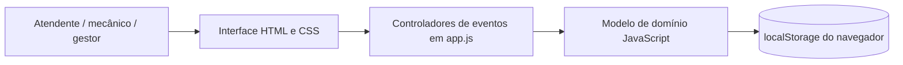

# Arquitetura — Primeiro Incremento

## Visão geral

O incremento é uma aplicação web estática, executada no navegador e sem etapa de compilação ou dependências de pacote. A separação lógica segue apresentação, domínio e persistência; nesta prova de conceito, a interface e os objetos de domínio ainda compartilham o arquivo `app.js`.

## Componentes e responsabilidades

| Componente | Implementação | Responsabilidade |
|---|---|---|
| Apresentação | `index.html`, `styles.css` | Formulários, fila de OS, resumo, detalhes e consulta. |
| Controle e domínio | `app.js` | Validação, criação dos objetos, regras de status, cálculo e atualização da interface. |
| Persistência | `localStorage` | Guardar clientes, veículos e ordens em formato JSON no navegador atual. |

## Fluxo principal

1. Atendente cadastra cliente e veículo; o sistema valida documento, placa e unicidade local.
2. Atendente seleciona um veículo cadastrado e abre uma OS numerada no status `Aberta`.
3. Mecânico lança itens de mão de obra, que compõem o total calculado pela OS.
4. Operador avança o status conforme a máquina definida; cada transição inclui instante e responsável.
5. A fila e a busca por OS ou placa consultam os dados persistidos no navegador.

## Decisões e restrições

- HTML, CSS e JavaScript nativos mantêm o incremento simples de executar e revisar, sem servidor de aplicação.
- O modelo de domínio contém `Cliente`, `Veiculo`, `OrdemServico`, `ServicoExecutado` e `HistoricoStatus`; o detalhamento está em [uml.md](uml.md).
- O `localStorage` é adequado apenas à demonstração: não oferece transações, controle multiusuário, sincronização ou backup.
- A busca de acompanhamento é uma demonstração local. Ela não autentica o cliente nem restringe quais OS podem ser consultadas.
- O histórico registra as transições na aplicação, mas não é imutável nem resistente a edição pelo usuário do navegador.

## Mudança futura e manutenção

Uma evolução provável é permitir que atendentes e mecânicos usem o sistema em diferentes computadores, mantendo uma base compartilhada e acesso autenticado. A migração do armazenamento local para uma API e um banco relacional, junto com a adaptação da aplicação ao ambiente cliente-servidor, caracteriza **manutenção adaptativa**. Nessa mudança, os dados pessoais também exigirão autenticação, autorização por perfil, backups e política de privacidade antes de uso real.

Adicionar estoque de peças, não previsto no fluxo atual, seria uma ampliação de capacidade e se enquadraria como **manutenção perfectiva**.

## Execução

1. Abra a pasta `oficina_mecanica` no VS Code.
2. No terminal, na raiz do projeto, inicie um servidor estático com `python3 -m http.server 8000`.
3. Acesse `http://localhost:8000` no navegador. Nenhuma instalação de dependências é necessária.
4. Os dados ficam no armazenamento local desse navegador. Para iniciar uma demonstração limpa, remova os dados do site nas ferramentas de armazenamento do navegador.

Também é possível abrir `index.html` diretamente, embora servir a pasta por HTTP torne a persistência do navegador mais previsível.