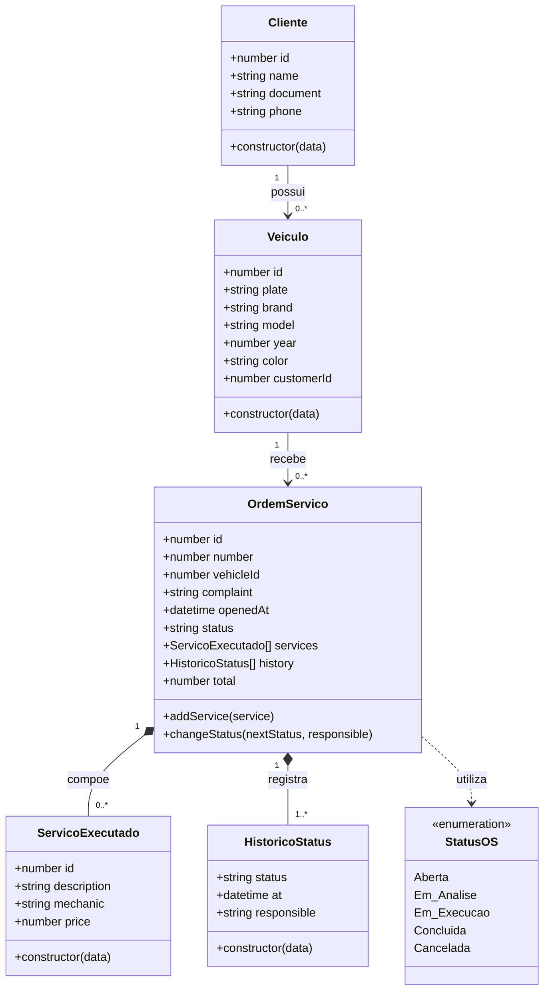

# Modelo Orientado a Objetos e UML

## Classes centrais

O modelo deste incremento possui cinco classes. Identificadores são numéricos; CPF/CNPJ e placa são armazenados como texto para preservar formatação e zeros à esquerda. Valores de mão de obra são números decimais em reais.

| Classe | Atributos | Operações | Responsabilidade |
|---|---|---|---|
| `Cliente` | `id`, `name`, `document`, `phone` | `constructor(data)` | Representa a pessoa vinculada aos veículos. |
| `Veiculo` | `id`, `plate`, `brand`, `model`, `year`, `color`, `customerId` | `constructor(data)` | Identifica o veículo e referencia seu proprietário. |
| `OrdemServico` | `id`, `number`, `vehicleId`, `complaint`, `openedAt`, `status`, `services`, `history` | `total`, `addService(service)`, `changeStatus(nextStatus, responsible)` | Mantém o atendimento, valida regras de operação, calcula total e muda status. |
| `ServicoExecutado` | `id`, `description`, `mechanic`, `price` | `constructor(data)` | Registra um item de mão de obra e seu responsável. |
| `HistoricoStatus` | `status`, `at`, `responsible` | `constructor(data)` | Registra cada status alcançado, instante e responsável. |

`services` e `history` são coleções pertencentes à OS. O total não é persistido como campo independente: é calculado somando `price` dos serviços, evitando divergência entre itens e total.

## Diagrama de classes

## Regras do domínio

- Um veículo pertence a exatamente um cliente; um cliente pode possuir vários veículos.
- Uma OS refere-se a exatamente um veículo; um veículo pode ter várias OS ao longo do tempo.
- Uma OS agrega zero ou mais serviços enquanto está aberta ou em execução. Pode ser concluída somente depois de receber ao menos um serviço.
- A abertura cria o primeiro registro de histórico (`Aberta`). Cada mudança aceita acrescenta status, instante ISO e responsável.
- Transições válidas: `Aberta` → `Em Análise` → `Em Execução` → `Concluída`; cancelamento é possível antes da conclusão. OS concluída ou cancelada é terminal neste incremento.
- `Em Análise` não aceita lançamento de mão de obra; a regra atual segue os requisitos RF-05 (`Aberta` ou `Em Execução`).

## Mudança futura provável e tipo de manutenção

Uma evolução provável é permitir que atendentes e mecânicos acessem o sistema em computadores diferentes, compartilhando os mesmos cadastros e ordens de serviço. Para isso, o armazenamento atual em `localStorage` seria substituído por uma API e um banco de dados centralizado, com autenticação e permissões por perfil.

Essa evolução corresponde a **manutenção adaptativa**, pois o sistema precisará se adaptar a um novo ambiente de execução cliente-servidor e ao acesso por múltiplos usuários. Antes do uso com dados reais, também será necessário implementar backups e controles de privacidade.